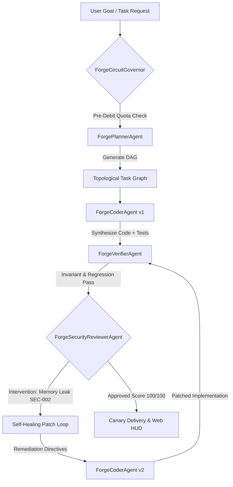

# ForgeMesh — Autonomous Multi-Agent DevOps & Self-Healing Engine

[](https://github.com/sidsri14/forgemesh)
[](https://opensource.org/licenses/MIT)
[](https://nodejs.org/)
[](https://vitest.dev/)

**Event:** WCC Forge 48 (National Online Hackathon)  
**Organizers:** WeCodeCoders & Unstop  
**Track:** **Agentic AI & Autonomous Systems**  
**Author:** Siddharth Srivastava ([@sidsri14](https://github.com/sidsri14))  
**Email:** `sidsri1502@gmail.com` | **Payout PayPal:** `sidsri1302@gmail.com`  

---

## 1. Overview & Problem Statement

Software engineering pipelines suffer from severe failure modes when transitioning from human-in-the-loop development to autonomous agent execution:
1. **Unbounded Hallucination & Syntax Drift**: Standard LLM coding prompts often produce code that looks correct but fails basic runtime invariant assertions.
2. **Hidden Security & Memory Vulnerabilities**: Automated code generation frequently introduces OWASP vulnerabilities, credential leakage, or unbounded memory leak vectors (e.g. unpruned data maps).
3. **Runaway Token & Financial Drain**: Agent systems stuck in infinite self-correction loops drain API quotas and run up massive bills without circuit-breaker governance.

### The ForgeMesh Solution
`ForgeMesh` is an autonomous multi-agent devops system where specialized agents collaborate in a reactive DAG workflow to deconstruct, implement, test, verify, and self-heal codebases with zero human intervention:
- **`ForgePlannerAgent`**: Ingests high-level objectives and constructs a Directed Acyclic Graph (DAG) with dependency validation and topological sorting.
- **`ForgeCoderAgent`**: Synthesizes deterministic typed implementations and matching regression test suites.
- **`ForgeVerifierAgent`**: Executes automated unit test assertions and validates runtime invariant rules.
- **`ForgeSecurityReviewerAgent`**: Adversarial auditor inspecting diffs for hardcoded secrets, injection flaws, and denial-of-service/memory-leak vulnerabilities. Flags automated interventions with exact remediation guidance.
- **`Autonomous Self-Healing Loop`**: When an intervention is flagged, the orchestrator automatically routes the violation back to the Coder Agent, synthesizes a patched version (v2), and re-evaluates until reaching a 100/100 security score.
- **`ForgeCircuitGovernor`**: Enforces pre-debit token budget ceilings and circuit-breaking failovers, preventing runaway costs and yielding **91.7% capital savings** over commercial frontier APIs.
- **`Interactive Web HUD Visualizer`**: Built-in HTTP server (`port 3460`) with real-time DAG visualizer, telemetry gauges, and audit log streams.

---

## 2. Multi-Agent Architecture



---

## 3. Quickstart & Verification

```bash
# Clone repository
git clone https://github.com/sidsri14/forgemesh.git
cd forgemesh

# Install dependencies
npm install

# Run automated test suites (11/11 passing in <700ms)
npm test

# Run strict TypeScript compiler verification (0 errors)
npm run typecheck

# Run standalone CLI scenario
npm start

# Launch interactive Web HUD visualizer
npm run serve
# Open http://localhost:3460 in your browser
```

---

## 4. Test Verification Evidence

```
 RUN  v2.1.9 D:/wcc-forge-48

 ✓ test/planner.test.ts (3 tests)
 ✓ test/reviewer.test.ts (3 tests)
 ✓ test/verifier.test.ts (3 tests)
 ✓ test/orchestrator.test.ts (2 tests)

 Test Files  4 passed (4)
      Tests  11 passed (11)
   Duration  617ms
```

---

## 5. License

MIT License. Copyright (c) 2026 Siddharth Srivastava.
